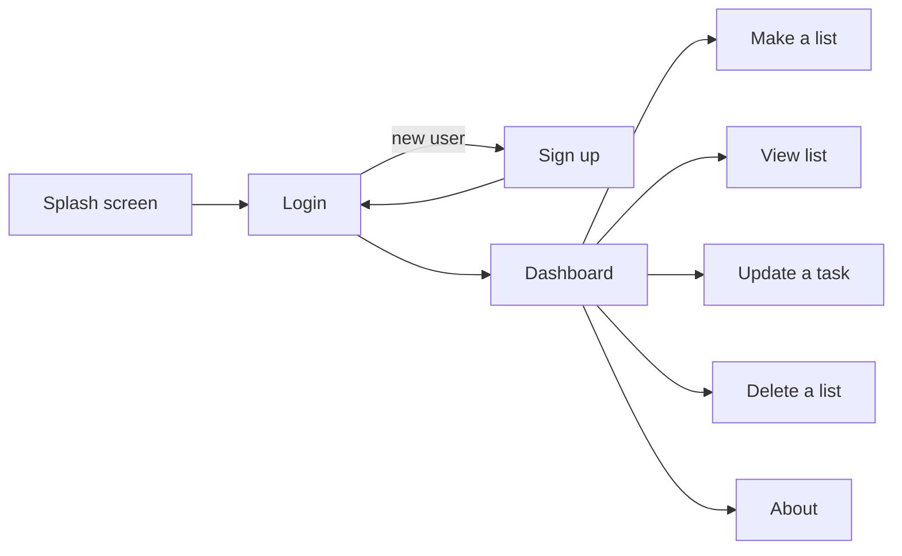

# Mytinerary

A desktop to-do list app in Java Swing with user accounts. You sign up, log in, and keep your lists in a MySQL database: make a list, view it, update a task or delete one. Built in 2020 during my undergrad.

## How it flows

- **Splash screen** with a loading bar, then the login window.
- **Sign up** stores the new user's name, email and password in a `logindatabase` table.
- **Dashboard** has a side menu for making, viewing, updating and deleting lists. The list view is a `JTable` filled straight from the `data` table (via `rs2xml`'s `DbUtils`).
- All database writes use `PreparedStatement`s.

## Code

| File | What it does |
|---|---|
| `src/inventorysoftware/LogIn/SpalshScreen.java` | Splash screen with a progress bar |
| `src/inventorysoftware/LogIn/LoginPages2.java` | Login window |
| `src/inventorysoftware/LogIn/NewSignin.java` | Sign-up form |
| `src/inventorysoftware/LogIn/dashboard.java` | Main window: make, view, update and delete lists |

The windows were laid out with the NetBeans GUI builder (the `.form` files).

## Running it

1. Open the project in NetBeans.
2. Add the MySQL JDBC driver, `rs2xml.jar` and NetBeans' `AbsoluteLayout` library to the project libraries.
3. Create two MySQL databases on `localhost:3306`:
   - `signin`, with a `logindatabase` table (`Email`, `Password`, `Fname`, `Lname`, `Cpwd`)
   - `list`, with a `data` table (`id`, `task`)
4. Run `inventorysoftware.InventorySoftware`.

## Looking back

If I built this today I'd hash passwords instead of storing them as plain text, move the database URL and credentials into a config file, and give each user their own lists instead of one shared table.
